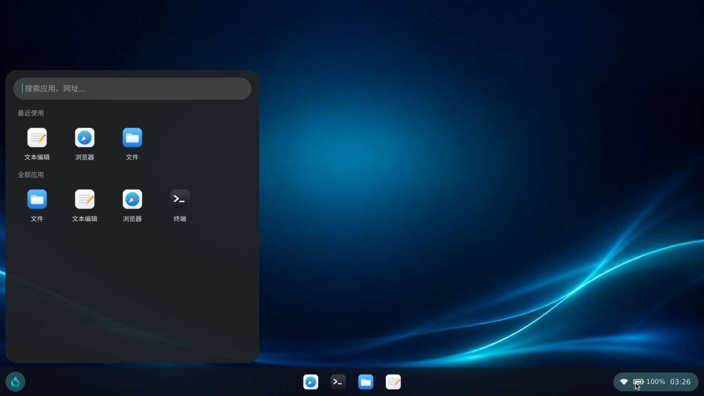

# 水滴 Shabnam

**水滴**（Shabnam，波斯语里的「水滴」）把一台中国移动「云电脑」笔记本（EC-NB01-CE）变成两样东西：

1. **一台能独立使用的小电脑**：开机直接进入一个 Rust 写的桌面，不经过安卓界面。
2. **Mac 的第二块屏幕**：用一根 Type-C 数据线连接，画面、声音走线缆，笔记本的键盘和触摸板可以反过来控制 Mac。

*Shabnam turns a China Mobile "cloud PC" laptop (EC-NB01-CE, RK3568) into a standalone machine
with a Rust desktop, and into a wired second screen for a Mac. Documentation is in Chinese for
now; the Mac app has its own English README in `linux-rust/mac/ShabnamDisplay/`.*

> **状态：个人项目，实验阶段。** 这里的脚本和补丁是针对这一款机器、这一台设备写的。
> 其中有写启动分区的步骤，这款机器没有可用的刷机通道，写错了无法恢复。
> 不要在没有读懂的情况下照着操作。



Mac 端的设置窗口：


## 硬件

| 项目 | 规格 |
|---|---|
| 型号 | 中国移动云电脑 EC-NB01-CE |
| 处理器 | Rockchip RK3568，4 核 Cortex-A55 |
| 内存 / 存储 | 4 GB / eMMC |
| 屏幕 | 1920×1080 eDP，桌面按 1.5 倍缩放（可用空间 1280×720） |
| 显卡 | Mali-G52，使用厂商的 GLES 驱动（不含在本仓库） |
| 接口 | 两个 Type-C（A 口可作数据设备，B 口只负责充电）、HDMI |
| 原系统 | Android 11，内核 4.19 |

## 能做什么

### 独立使用

- **桌面**：[niri](https://github.com/YaLTeR/niri) 合成器（打了适配 Mali 驱动的补丁）加自己写的
  `shabnam-shell`：底栏、启动器、快捷设置、音量和亮度提示。外观参考 ChromeOS 的布局和 macOS 的图标风格。
- **应用**：Chromium 浏览器（网页视频硬件解码）、foot 终端加 fish、图形界面的文件管理器（Favnyr，Rust + Slint，自己编译；终端里另有 yazi）、文本编辑（Helix）、硬件解码的视频播放器。
- **中文**：Noto CJK 字体，fcitx5 拼音输入法。
- **系统**：Wi-Fi（wpa_supplicant，可在快捷设置里切换网络）、声音（PipeWire）、
  对时（ntpd-rs）、亮度和音量键、合盖关屏、关机和重启。

### 作为 Mac 的副屏

- Mac 上运行菜单栏应用 **Shabnam Display**，笔记本上按 `Win+Esc` 进入副屏模式，再按一次回到桌面。
- Mac 多出一块真正的扩展屏幕（1920×1080，HiDPI），1080p60，H.264 硬件编码，笔记本硬件解码。
- 声音三种模式：Mac 和笔记本同时响、只有笔记本响、不传声音。
- 笔记本的键盘、触摸板、外接 USB 键鼠可以控制 Mac。
- 线缆上的连接有双向认证（预共享密钥），只在线缆网口上监听。

## 它是怎么启动的

这台机器的刷机通道是封死的，所以内核、驱动和分区都保持原样，安卓只剩下「把内核带起来」的作用：

```
通电
 └─ 原厂引导程序 + 原厂 Android 内核（开机画面已换成 Shabnam 标志）
     └─ Android init 执行一个加进去的服务（device/boot/void-desktop.rc）
         └─ boot.sh：停掉安卓的界面和大部分服务，配置 USB 网络
             └─ 进入 /data/void 里的 Void Linux（glibc）
                 └─ session.sh：在两种模式之间循环
                     ├─ 桌面模式：niri + shabnam-shell
                     └─ 副屏模式：subscreen-rx
```

安全措施：存在 `/data/void-boot/disabled` 时回到安卓；上一次启动没有成功的话，下一次自动回到安卓。

## 安装到一台新机器

下面从「`adb` 已经能连上这台机器、`adb root` 能拿到 `uid=0`」讲起。怎么从锁死状态开出网络
adb、拿到 root（人工约 5 分钟，零内核漏洞，不刷机），见仓库根目录的
《EC-NB01-最短路径教程.md》第一部分。

安装需要的两样东西在本仓库的 [Releases](../../releases/latest) 里，都已去除密钥和个人数据：

| 文件 | 内容 |
|---|---|
| `shabnam-rootfs-<日期>.tar.gz` | 装好的 Void 系统整包（约 1.5 GB，解开约 4.5 GB）：打过补丁的 niri、桌面外壳、全部应用，以及厂商的 Mali / Rockchip MPP 库 |
| `ShabnamDisplay-<版本>-mac.zip` | Mac 端副屏应用（Apple Silicon） |

> 下面有写入 `/vendor` 和替换启动流程的步骤。这款机器没有可用的刷机通道，
> **动手前务必先做第 1 步的备份、并实测 fastboot 救砖通道可用**。

### 1. 备份与救砖通道（动分区前必做）

```sh
# 充电口侧（port0）接 Mac
adb pull /dev/block/by-name/boot   boot.img
adb pull /dev/block/by-name/vendor vendor.img   # 第 2 步会改 vendor
# 拉取前后各算一次 sha256，必须一致

adb reboot bootloader
fastboot devices               # 必须列出设备，否则不要继续
fastboot flash boot boot.img   # 把刚备份的写回，验证通道可用
fastboot reboot
```

两条铁律：永远不用 `fastboot getvar all`（会卡死机器）；`reboot bootloader` 后先确认
`fastboot devices` 在线，再做任何不可逆操作。

### 2. USB 外设模式（副屏和高速传输靠它）

原厂内核的 USB 控制器只有主机模式。几个为原厂内核编译、CRC 已核对的内核模块在 `kmod/`：

```sh
adb push kmod/dwc3_gadget_otg.ko kmod/usb_f_ncm.ko kmod/usb_f_ecm.ko /vendor/lib/modules/
adb push kmod/device-files/usb-gadget.sh  /vendor/bin/
adb push kmod/device-files/usb-gadget.rc  /vendor/etc/init/
adb reboot
```

之后用 port0 接 Mac，会多出一个 USB adb 接口（约 33 MB/s，Wi-Fi 只有 1.5）。

### 3. 装系统

```sh
# 先对照 Release 页上的校验值
shasum -a 256 shabnam-rootfs-<日期>.tar.gz

# 推到设备，用设备自带的 gzip 解开到 /data/void
adb push shabnam-rootfs-<日期>.tar.gz /data/local/tmp/
adb shell 'su 0 sh -c "mkdir -p /data/void && cd /data/void && \
  gzip -dc /data/local/tmp/shabnam-rootfs-<日期>.tar.gz | tar x && sync"'

# 放启动脚本与会话脚本（session.sh 已在整包里的 /root 下）
adb push linux-rust/device/void.sh              /data/void.sh
adb push linux-rust/device/boot/boot.sh         /data/void-boot/boot.sh
adb push linux-rust/device/usb-net.sh           /data/void-boot/usb-net.sh
adb push linux-rust/device/boot/void-desktop.rc /vendor/etc/init/
adb shell 'su 0 sh -c "chmod 755 /data/void.sh /data/void-boot/*.sh; \
  rm -f /data/local/tmp/shabnam-rootfs-*.tar.gz"'
```

整包里不含 Wi-Fi 配置。建一个空的配置骨架，网络进桌面后在快捷设置里连：

```sh
adb shell 'su 0 sh -c "mkdir -p /data/void/etc/wpa_supplicant && \
  printf \"ctrl_interface=/run/wpa_supplicant\nupdate_config=1\n\" \
  > /data/void/etc/wpa_supplicant/wpa_supplicant-wlan0.conf && \
  chmod 600 /data/void/etc/wpa_supplicant/wpa_supplicant-wlan0.conf"'
```

### 4. 重启进入桌面

```sh
adb reboot
```

重启后不再进安卓，直接进 Shabnam 桌面。第一次进去按 `Win+S` 打开快捷设置连 Wi-Fi。

出问题时的安全网：`adb shell 'su 0 touch /data/void-boot/disabled'` 再重启，即回到安卓
（原系统分文未动）；上一次没启动成功，下一次也会自动回到安卓。

### 5. Mac 副屏端

解开 `ShabnamDisplay-<版本>-mac.zip`，把 `Shabnam Display.app` 拖进「应用程序」。应用未经
公证，第一次打开时按住 Control 点图标选「打开」。线缆接 port0，笔记本按 `Win+Esc` 进入副屏。

副屏连接用预共享密钥双向认证；密钥不在整包里，需要在笔记本的 `/root/subscreen.key` 与 Mac 的
`~/.config/subscreen/key` 各放同一份（两端内容一致即可）。

## 目录

| 路径 | 内容 |
|---|---|
| `linux-rust/shabnam-shell/` | 桌面外壳：底栏、启动器、快捷设置。Rust，用处理器绘制（wl_shm），不依赖显卡驱动 |
| `linux-rust/subscreen-rx/` | 副屏接收端：Rockchip MPP 硬解 H.264，直接用 KMS 显示，ALSA 播放，转发输入事件。另含开机画面程序 `shabnam-splash` |
| `linux-rust/mac/ShabnamDisplay/` | Mac 菜单栏应用（Swift）：虚拟显示器、屏幕捕获、编码、声音、输入注入、设置窗口。有独立的 README 和协议文档 |
| `linux-rust/shabnam-video/` | 视频播放器：GStreamer 加瑞芯微硬解插件（`mppvideodec`），解出的画面直接交给合成器，不经处理器拷贝。C，约 900 行 |
| `linux-rust/files/` | 文件管理器 Favnyr 的交叉编译脚本（只有脚本，不含源码）；启动包装是 `device/shabnam-files`，文件类型关联在 `device/etc/xdg-mimeapps.list` |
| `linux-rust/device/` | 装在笔记本上的脚本和配置：启动、会话、Wi-Fi、声音、浏览器包装、输入法、终端、niri 配置 |
| `linux-rust/patches/` | niri 和 smithay 适配 Mali 驱动的补丁 |
| `linux-rust/branding/` | 标志、壁纸、开机画面、应用图标 |
| `kmod/` | 为原厂内核编译的几个内核模块（USB 网络等）和相关工具 |
| `docs/` | 设计文档和图片 |

## 快捷键

`Win` 就是键盘上的 Windows 键。

| 键 | 作用 |
|---|---|
| `Win+空格` / `Win+D` | 启动器 |
| `Win+S` | 快捷设置 |
| `Win+T` / `Win+回车` | 终端 |
| `Win+B` | 浏览器 |
| `Win+Q` / `Win+W` / `Alt+F4` | 关闭窗口 |
| `Win+Tab`、`Win+←/→` | 切换窗口 |
| `Win+F` / `Win+R` | 窗口占满 / 在半宽、三分之二、全宽之间切换 |
| `Ctrl+空格` | 中英文切换 |
| `Win+Esc` | 在桌面和 Mac 副屏之间切换 |

## 视频播放器

`shabnam-player 文件或网址`，启动器里叫「视频」。画面由 RK3568 的硬件解码器解码（GStreamer `mppvideodec`），
再由芯片里的图像转换硬件（RGA）转成合成器能直接显示的格式交出去，处理器不碰像素。
网页地址由 yt-dlp 解析为不高于 1080p 的 H.264 流，不登录任何账号。播放器以普通用户运行。

真机屏幕上实测（1080p）：

| 片源 | 显示帧率 | 丢帧 | 播放器占用 | 合成器占用 |
|---|---|---|---|---|
| H.264 60 帧，硬解 | 59.8 | 0 | 0.4 个核 | 0.5 个核 |
| HEVC 60 帧，硬解 | 59.7 | 0 | 0.4 个核 | 0.55 个核 |
| H.264 30 帧，硬解 | 29.9 | 0 | 0.24 个核 | 0.3 个核 |
| H.264 30 帧，软解 | 16.8 | 有 | 3 个核 | 0.4 个核 |

按键：空格暂停，`←/→` 快退快进 10 秒（加 Shift 为 60 秒），`↑/↓` 音量，`M` 静音，`F` 或双击全屏，`Esc` 退出全屏，`Q` 退出。

限制：不显示字幕；不支持 10 位色片源；网页地址解析需 15–25 秒；合成器目前不能直接显示解码器输出的 NV12 画面，
所以多了一步 RGA 转换，这一步依赖瑞芯微预编译的 `librga`（不在本仓库）。

## 构建

所有东西都在 Mac 上交叉编译，不在笔记本上编译。需要 Rust、`cargo-zigbuild`、Zig，以及一份从设备上拷出来的 `/usr` 作为 sysroot。

```sh
# 桌面外壳
SYSROOT=<sysroot> linux-rust/shabnam-shell/build.sh

# 副屏接收端（还需要 Rockchip MPP 的库）
cd linux-rust/subscreen-rx
RUSTFLAGS="-L native=<mpp>/usr/lib/aarch64-linux-gnu -L native=<sysroot>/usr/lib" \
  cargo zigbuild --release --target aarch64-unknown-linux-gnu.2.41

# Mac 应用
cd linux-rust/mac/ShabnamDisplay && make app
```

## 已知的限制

- **浏览器没有沙箱。** 原厂内核没有编译用户命名空间，Chromium 的沙箱无法启动。
  浏览器以一个单独的受限用户运行，与桌面（root）隔开，只共享显示和声音两个连接。
- **浏览器里的视频硬解只覆盖 H.264 和 VP9。** 通过一个把 VA-API 接到瑞芯微解码器的开源小驱动（`rockchip-vaapi`，
  编译脚本在 `linux-rust/vaapi/`）实现，Chromium 仍是发行版原版。1080p 30 帧基本不丢帧；60 帧丢一成左右，
  要完全流畅请用视频播放器。AV1 和 10 位色片源芯片不支持，仍是软件解码。
- **休眠还没做。** 合盖目前只关背光。
- **桌面以 root 运行**，在一个 chroot 里，没有登录管理器。
- **依赖不在仓库里的东西**：厂商的 Mali 驱动、Rockchip MPP、Void Linux 根文件系统、打过补丁的 niri——
  这些都打包在 [Release](../../releases/latest) 的系统整包里，仓库里是对应的源码构建脚本和补丁。
- **Mac 端用了私有接口**（`CGVirtualDisplay`）创建虚拟显示器，不能上架 App Store。
- GPU 绘制的终端（Alacritty、WezTerm）在这个显卡驱动上无法工作，所以用了处理器绘制的 foot。

## 许可

尚未确定。`linux-rust/mac/ShabnamDisplay/` 暂时附了 MIT 许可文本。
Shabnam 的名称和水滴标志不随代码一起授权。
