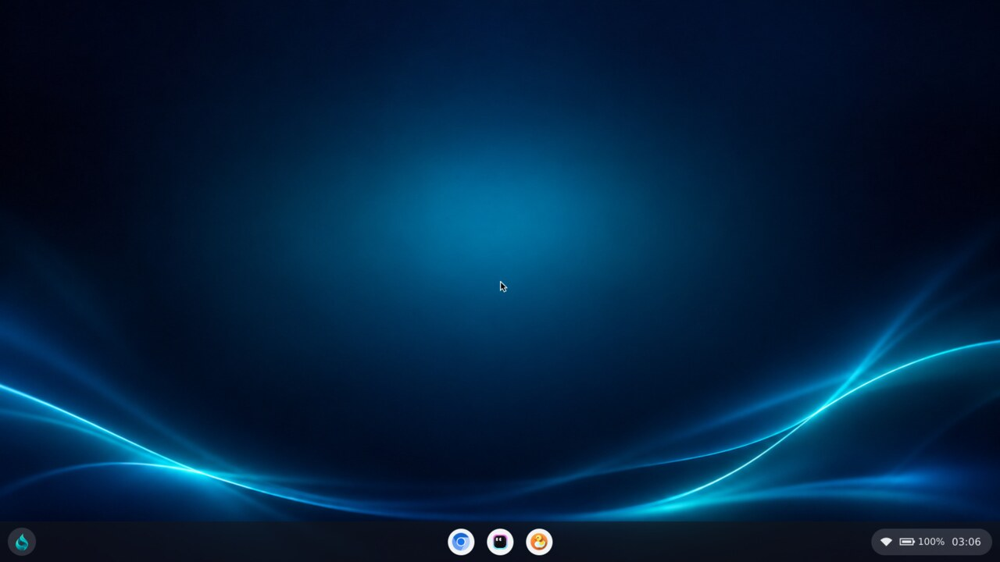
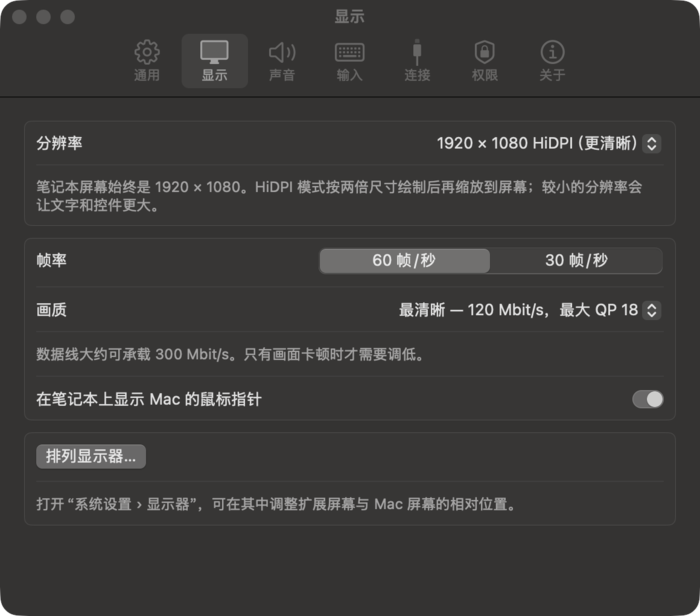

# Shabnam

把一台中国移动「云电脑」笔记本（EC-NB01-CE）变成两样东西：

1. **一台能独立使用的小电脑**：开机直接进入一个 Rust 写的桌面，不经过安卓界面。
2. **Mac 的第二块屏幕**：用一根 Type-C 数据线连接，画面、声音走线缆，笔记本的键盘和触摸板可以反过来控制 Mac。

*Shabnam turns a China Mobile "cloud PC" laptop (EC-NB01-CE, RK3568) into a standalone machine
with a Rust desktop, and into a wired second screen for a Mac. Documentation is in Chinese for
now; the Mac app has its own English README in `linux-rust/mac/ShabnamDisplay/`.*

> **状态：个人项目，实验阶段。** 这里的脚本和补丁是针对这一款机器、这一台设备写的。
> 其中有写启动分区的步骤，这款机器没有可用的刷机通道，写错了无法恢复。
> 不要在没有读懂的情况下照着操作。



| 启动器 | Mac 端设置 |
|---|---|
|  |  |

## 硬件

| 项目 | 规格 |
|---|---|
| 型号 | 中国移动云电脑 EC-NB01-CE |
| 处理器 | Rockchip RK3568，4 核 Cortex-A55 |
| 内存 / 存储 | 4 GB / eMMC |
| 屏幕 | 1920×1080 eDP，桌面按 1.5 倍缩放（可用空间 1280×720） |
| 显卡 | Mali-G52，使用厂商的 GLES 驱动（不含在本仓库） |
| 接口 | 两个 Type-C（A 口可作数据设备，B 口只负责充电）、HDMI |
| 原系统 | Android 11，内核 4.19 |

## 能做什么

### 独立使用

- **桌面**：[niri](https://github.com/YaLTeR/niri) 合成器（打了适配 Mali 驱动的补丁）加自己写的
  `shabnam-shell`：底栏、启动器、快捷设置、音量和亮度提示。外观参考 ChromeOS 的布局和 macOS 的图标风格。
- **应用**：Chromium 浏览器、foot 终端加 fish、文件管理（yazi）、文本编辑（Helix）。
- **中文**：Noto CJK 字体，fcitx5 拼音输入法。
- **系统**：Wi-Fi（wpa_supplicant，可在快捷设置里切换网络）、声音（PipeWire）、
  对时（ntpd-rs）、亮度和音量键、合盖关屏、关机和重启。

### 作为 Mac 的副屏

- Mac 上运行菜单栏应用 **Shabnam Display**，笔记本上按 `Win+Esc` 进入副屏模式，再按一次回到桌面。
- Mac 多出一块真正的扩展屏幕（1920×1080，HiDPI），1080p60，H.264 硬件编码，笔记本硬件解码。
- 声音三种模式：Mac 和笔记本同时响、只有笔记本响、不传声音。
- 笔记本的键盘、触摸板、外接 USB 键鼠可以控制 Mac。
- 线缆上的连接有双向认证（预共享密钥），只在线缆网口上监听。

## 它是怎么启动的

这台机器的刷机通道是封死的，所以内核、驱动和分区都保持原样，安卓只剩下「把内核带起来」的作用：

```
通电
 └─ 原厂引导程序 + 原厂 Android 内核（开机画面已换成 Shabnam 标志）
     └─ Android init 执行一个加进去的服务（device/boot/void-desktop.rc）
         └─ boot.sh：停掉安卓的界面和大部分服务，配置 USB 网络
             └─ 进入 /data/void 里的 Void Linux（glibc）
                 └─ session.sh：在两种模式之间循环
                     ├─ 桌面模式：niri + shabnam-shell
                     └─ 副屏模式：subscreen-rx
```

安全措施：存在 `/data/void-boot/disabled` 时回到安卓；上一次启动没有成功的话，下一次自动回到安卓。

## 目录

| 路径 | 内容 |
|---|---|
| `linux-rust/shabnam-shell/` | 桌面外壳：底栏、启动器、快捷设置。Rust，用处理器绘制（wl_shm），不依赖显卡驱动 |
| `linux-rust/subscreen-rx/` | 副屏接收端：Rockchip MPP 硬解 H.264，直接用 KMS 显示，ALSA 播放，转发输入事件。另含开机画面程序 `shabnam-splash` |
| `linux-rust/mac/ShabnamDisplay/` | Mac 菜单栏应用（Swift）：虚拟显示器、屏幕捕获、编码、声音、输入注入、设置窗口。有独立的 README 和协议文档 |
| `linux-rust/device/` | 装在笔记本上的脚本和配置：启动、会话、Wi-Fi、声音、浏览器包装、输入法、终端、niri 配置 |
| `linux-rust/patches/` | niri 和 smithay 适配 Mali 驱动的补丁 |
| `linux-rust/branding/` | 标志、壁纸、开机画面、应用图标 |
| `kmod/` | 为原厂内核编译的几个内核模块（USB 网络等）和相关工具 |
| `lan-helper/` | 更早阶段的工作：在安卓上做的局域网安装通道和 ChromeOS 风格安卓桌面。现在的系统不再使用 |
| `docs/` | 设计文档和图片 |

## 快捷键

`Win` 就是键盘上的 Windows 键。

| 键 | 作用 |
|---|---|
| `Win+空格` / `Win+D` | 启动器 |
| `Win+S` | 快捷设置 |
| `Win+T` / `Win+回车` | 终端 |
| `Win+B` | 浏览器 |
| `Win+Q` / `Win+W` / `Alt+F4` | 关闭窗口 |
| `Win+Tab`、`Win+←/→` | 切换窗口 |
| `Win+F` / `Win+R` | 窗口占满 / 在半宽、三分之二、全宽之间切换 |
| `Ctrl+空格` | 中英文切换 |
| `Win+Esc` | 在桌面和 Mac 副屏之间切换 |

## 构建

所有东西都在 Mac 上交叉编译，不在笔记本上编译。需要 Rust、`cargo-zigbuild`、Zig，以及一份从设备上拷出来的 `/usr` 作为 sysroot。

```sh
# 桌面外壳
SYSROOT=<sysroot> linux-rust/shabnam-shell/build.sh

# 副屏接收端（还需要 Rockchip MPP 的库）
cd linux-rust/subscreen-rx
RUSTFLAGS="-L native=<mpp>/usr/lib/aarch64-linux-gnu -L native=<sysroot>/usr/lib" \
  cargo zigbuild --release --target aarch64-unknown-linux-gnu.2.41

# Mac 应用
cd linux-rust/mac/ShabnamDisplay && make app
```

## 已知的限制

- **浏览器没有沙箱。** 原厂内核没有编译用户命名空间，Chromium 的沙箱无法启动。
  浏览器以一个单独的受限用户运行，与桌面（root）隔开，只共享显示和声音两个连接。
- **没有浏览器可用的视频硬解。** 网页视频是软件解码，1080p 会掉帧。
- **休眠还没做。** 合盖目前只关背光。
- **桌面以 root 运行**，在一个 chroot 里，没有登录管理器。
- **依赖不在仓库里的东西**：厂商的 Mali 驱动、Rockchip MPP、Void Linux 根文件系统、打过补丁的 niri。
- **Mac 端用了私有接口**（`CGVirtualDisplay`）创建虚拟显示器，不能上架 App Store。
- GPU 绘制的终端（Alacritty、WezTerm）在这个显卡驱动上无法工作，所以用了处理器绘制的 foot。

## 许可

尚未确定。`linux-rust/mac/ShabnamDisplay/` 暂时附了 MIT 许可文本。
Shabnam 的名称和水滴标志不随代码一起授权。
